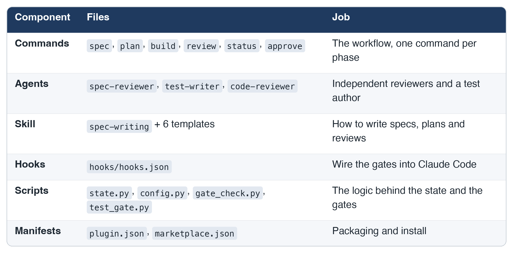
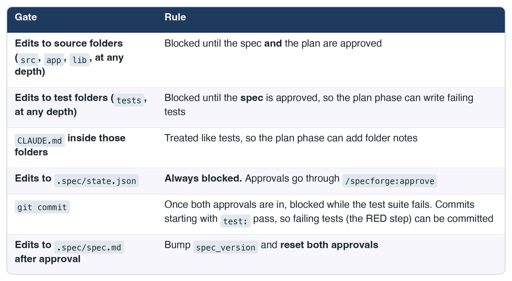
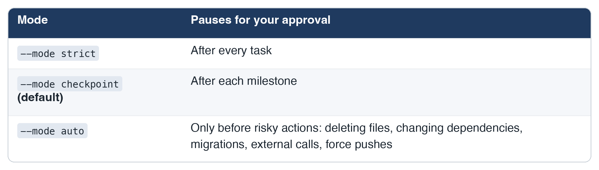
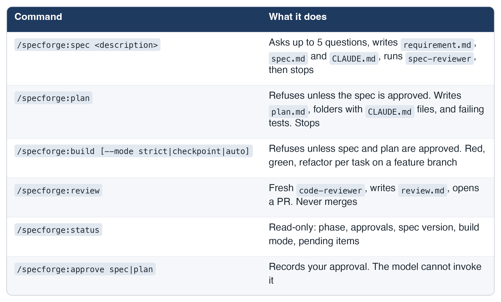
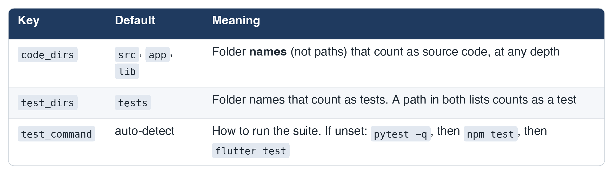

# Stop Letting AI Write Code Before You Approve the Plan

### I built Specforge, a Claude Code plugin that makes spec-driven development real, with approval gates that Claude cannot skip

*By Kumaran C S*

---

AI coding assistants are fast. That is also the problem.

Give one a vague prompt and it will happily write 800 lines before you have agreed on what "done" means. Then you spend the afternoon reviewing code that solves a slightly different problem than the one you had in mind.

The fix is old and boring: **write the spec first, agree on it, plan the work, write failing tests, and only then write code.** The hard part is not knowing this. The hard part is making an AI assistant actually follow it, every time, even when you are in a hurry.

So I built **Specforge**, a Claude Code plugin for spec-driven development with human approval gates. This post covers what it does, how the gates work, how I built it test-first, and a complete setup and usage guide you can follow today.

> **Repository:** `<your-repo-url>` (replace with your GitHub link before publishing)
> **License:** MIT. **Version:** 0.1.0.

---

## Table of contents

1. The problem with "just prompt it"
2. The idea: four phases, two human gates
3. What is in the plugin
4. How the gates really work
5. Building a plugin with strict TDD
6. Setup and installation
7. Using Specforge: the full step-by-step guide
8. Command reference
9. Configuration reference
10. An example session
11. Limitations (honest ones)
12. Troubleshooting
13. Project layout and contributing
14. What I would build next

---

## 1. The problem with "just prompt it"

A typical session goes like this:

1. You write a two-line prompt.
2. The assistant makes a dozen silent assumptions.
3. Code appears. Tests, if any, are written after the code and happen to pass.
4. You discover the wrong assumption in review, or worse, in production.

Three things are missing: a **shared definition of done**, a **checkpoint where a human says yes**, and **tests that exist before the code**. Prompts like "please write the spec first" help, but they are suggestions. The assistant can ignore them, forget them after a long context, or decide that this one time it is fine.

I wanted something stronger than a suggestion: rules that are enforced by the tool, not requested of the model.

## 2. The idea: four phases, two human gates

Specforge turns a feature into four phases:

```
 /specforge:spec <description>
        |  questions -> requirement.md, spec.md (AC-1, AC-2, ...), CLAUDE.md
        |  spec-reviewer checks it
        v
   [ YOU: /specforge:approve spec ]          spec_approved = true
        v
 /specforge:plan
        |  plan.md (tasks -> AC-IDs), folders + short CLAUDE.md files,
        |  test-writer creates FAILING tests from the acceptance criteria
        v
   [ YOU: /specforge:approve plan ]          plan_approved = true
        v
 /specforge:build [--mode strict|checkpoint|auto]
        |  feature branch; per task: RED (test:) -> GREEN (feat:) -> REFACTOR (refactor:)
        v
 /specforge:review
        |  fresh code-reviewer, review.md (every AC -> code -> test),
        |  full test results, then a pull request (never merged)
        v
      done            /specforge:status shows where you are at any time
```

Two ideas carry the whole design:

- **Acceptance criteria have IDs.** Every criterion in the spec is numbered `AC-1`, `AC-2`, and so on. Plan tasks reference those IDs. Tests are named after them. The final review maps every AC to the code that implements it and the test that proves it. Nothing falls through a crack because everything is traceable.
- **Approvals are state, and hooks read the state.** Your approval is recorded in `.spec/state.json`. Claude Code hooks check it on every file edit and every commit. If the approval is missing, the action is blocked and Claude is told why.

## 3. What is in the plugin



A few details worth calling out:

- **The reviewers are read-only.** `spec-reviewer` and `code-reviewer` only get the `Read`, `Grep` and `Glob` tools. They cannot "helpfully" fix what they find.
- **`test-writer` works from acceptance criteria only.** It is told not to read implementation, to name each test after its AC-ID, and to produce tests that fail for the right reason (the feature is missing, not a typo in the test).
- **`/specforge:approve` cannot be called by the model.** It is marked `disable-model-invocation: true`, so approval stays a human act.
- **`/specforge:review` never merges.** It opens a pull request, as a draft if any criterion is failing or missing, and stops.

## 4. How the gates really work

Claude Code hooks are scripts that run before or after a tool call. A `PreToolUse` hook that exits with code `2` blocks the call, and whatever it prints to stderr is shown to Claude as the reason. Specforge uses three hooks:

```json
{
  "hooks": {
    "PreToolUse": [
      { "matcher": "Edit|Write|MultiEdit",
        "hooks": [{ "type": "command", "command": "python3",
                    "args": ["${CLAUDE_PLUGIN_ROOT}/scripts/gate_check.py"],
                    "timeout": 10, "onFailure": "block" }] },
      { "matcher": "Bash",
        "hooks": [
          { "type": "command", "command": "python3",
            "args": ["${CLAUDE_PLUGIN_ROOT}/scripts/gate_check.py"],
            "timeout": 10, "onFailure": "block" },
          { "type": "command", "command": "python3",
            "args": ["${CLAUDE_PLUGIN_ROOT}/scripts/test_gate.py"],
            "timeout": 330, "onFailure": "block" } ] }
    ],
    "PostToolUse": [
      { "matcher": "Edit|Write|MultiEdit",
        "hooks": [{ "type": "command", "command": "python3",
                    "args": ["${CLAUDE_PLUGIN_ROOT}/scripts/gate_check.py", "--post"],
                    "timeout": 10 }] }
    ]
  }
}
```

### The state file

Everything hangs off one small file in your project, `.spec/state.json`:

```json
{ "phase": "spec", "spec_approved": false, "plan_approved": false,
  "spec_version": 1, "build_mode": "checkpoint" }
```

`state.py` is the only thing that writes it. It validates every field, rejects unknown keys, refuses to approve the plan before the spec, and writes atomically (temp file, then rename) so a crash never leaves half a file.

### The rules



Folder matching is by path segment, so `app/models/user.py` and `pkg/src/deep/x.py` are source, and `app/tests/test_y.py` is a test (a path in both counts as a test). Look-alikes such as `srcs/` or `library/` are not matched. Paths are resolved first, so `docs/../src/a.py` and symlinks into `src/` cannot dodge the gate.

### Fail closed

A gate that fails open is not a gate. Every script follows the same rule: **if something is wrong, block and say why.**

- Corrupt or unreadable `state.json`: code edits are blocked, with a message pointing at the problem.
- Missing state inside an existing `.spec/` folder: blocked, with "Run `/specforge:spec`".
- Malformed hook input, or any unexpected exception in a script: exit `2`.
- A crashing or timing-out hook: `"onFailure": "block"` makes it block too (this needs Claude Code 2.1.295 or later).
- No `.spec/` folder at all: the plugin stays out of the way, so it never interferes with unrelated projects.

A blocked edit looks like this to Claude:

```
specforge: blocked edit to src/app.py. The spec is not approved yet.
Review .spec/spec.md, then run /specforge:approve spec.
```

## 5. Building a plugin with strict TDD

I built Specforge with strict test-driven development, and I think the way I did it is useful beyond this plugin.

**The loop for every piece:** write a failing test, run it and watch it fail, commit with `test:`. Write the minimum code to pass, run the whole suite, commit with `feat:`. Refactor with the tests green, commit with `refactor:`. The git history shows the pairs: `test: add state.py behavior tests` followed by `feat: add state.py for workflow state and approvals`, and so on.

**Prompts cannot be unit tested, so I tested what can be tested:**

- *Behavior tests* for all the scripts: state handling, gate decisions across every combination of approvals, the commit gate, and the hooks. For the hooks, a few tests run the exact command from `hooks.json` as a real subprocess with a real JSON event on stdin and check the exit code.
- *Structure tests* for everything that is a prompt or a file: `plugin.json` and `marketplace.json` are valid and consistent; every command and agent has frontmatter and a description; components live at the plugin root, not inside `.claude-plugin/`; templates contain the required sections; reviewers have read-only tool lists; `test-writer` is told to use acceptance criteria only; commands contain the refusal wording; every agent a command launches actually exists; the README's install commands match the real marketplace name.

The suite finished at **376 passing tests**, and `claude plugin validate` passes for both the plugin and the marketplace.

**Writing tests first found real design problems before any code existed.** These are worth sharing because they are the kind of thing you only notice when you write the test for it:

1. **The plan phase contradicted the gates.** The plan asks `test-writer` to create failing tests *before* the plan is approved, but "block all code edits until both approvals" would block them. The fix: test folders open once the **spec** is approved; only source folders need both.
2. **The same conflict for `CLAUDE.md` files.** The plan phase creates a short `CLAUDE.md` inside each source folder. Those are documentation, so they are treated like tests.
3. **A commit gate that deadlocks.** "Block commits while tests fail" would block the commit of the failing tests themselves. The fix: commits with a `test:` prefix pass. It would also block committing `plan.md` during planning, so the commit gate only switches on after both approvals.
4. **A chained-command loophole.** `git commit -m "test: x" && git commit -m "feat: y"` would sail through if only the first message were checked. Now every commit in the command must be a `test:` commit.
5. **An `if` filter that fails open.** Filtering the hook with `Bash(git commit*)` would miss `git -C dir commit`. I removed the filter and let the script decide, so nothing slips through.
6. **A self-approval hole.** If Claude can edit `state.json`, it can approve its own work. Direct edits are blocked, shell writes are blocked on a best-effort basis, and the approve command is hidden from the model.

## 6. Setup and installation

### Prerequisites

- **Claude Code 2.1.295 or later.** Older versions ignore `onFailure: block`, so a crashing hook would not block. Check with `claude --version`.
- **`python3`** on your PATH (the hook scripts use only the standard library).
- **`git`**, and **`gh`** (GitHub CLI) if you want `/specforge:review` to open pull requests.
- A test runner for your project: `pytest`, `npm test` or `flutter test` are detected automatically; anything else can be set in a config file.

### Install

Do these in order. **Enter each slash command on its own line, one at a time.** Pasting several together fails, and so does a path that wraps across lines.

**Step 1: add the marketplace.** Use the absolute path of your clone of the repository:

```
/plugin marketplace add /absolute/path/to/specforge
```

Or from a shell:

```
claude plugin marketplace add /absolute/path/to/specforge
```

**Step 2: install the plugin:**

```
/plugin install specforge@specforge-marketplace
```

Or from a shell:

```
claude plugin install specforge@specforge-marketplace
```

**Step 3: check that it is installed.** In a shell:

```
claude plugin list
```

You should see `specforge@specforge-marketplace` with `Status: enabled`.

**Step 4: reload.** In a session that was already open:

```
/reload-plugins
```

Type `/specforge:` and the six commands should appear: `spec`, `plan`, `build`, `review`, `status`, `approve`.

To uninstall: `claude plugin marketplace remove specforge-marketplace`. Because the marketplace is a local folder, edits to the plugin take effect on the next `/reload-plugins`.

### Prepare a project

Any folder under git works. A Python example:

```bash
mkdir my-project && cd my-project
git init -b main
python3 -m venv .venv && .venv/bin/pip install pytest
printf '.venv/\n__pycache__/\n.pytest_cache/\n' > .gitignore
git add -A && git commit -m "chore: init"
```

If `pytest` is not on your PATH (it lives in the virtualenv), tell Specforge how to run tests by creating `.spec/config.json`:

```json
{ "test_command": ".venv/bin/pytest -q" }
```

## 7. Using Specforge: the full step-by-step guide

From here on, this is the loop for every feature. Start Claude Code in the project folder with `claude`.

### Step 1: check the starting point

```
/specforge:status
```

Expect: no workflow yet, and a hint to run `/specforge:spec`.

### Step 2: write the spec

```
/specforge:spec REST API for todos: create, list, complete, delete. In memory, no auth.
```

Claude asks up to five clarifying questions, and only ones that change the spec. Answer them. Expect these files:

- `.spec/requirement.md`: the problem, users, requirements, constraints, open questions
- `.spec/spec.md`: goal, scope, out of scope, **acceptance criteria with IDs**, edge cases
- `CLAUDE.md` in the project root: the project rules, including "every test traces to an AC-ID"

The `spec-reviewer` agent then checks the spec for untestable criteria, ID gaps, scope contradictions, missing edge cases and ambiguity, and returns a verdict. Claude summarizes and **stops**. It does not start planning.

A good criterion looks like this:

```
AC-3: Given an empty todo list, when the client requests GET /todos,
      then the response is 200 with an empty array.
```

A bad one is "The API should be fast and handle errors well." The reviewer will flag it.

### Step 3: review the spec

Open `.spec/spec.md`. Edit it, or ask Claude to change it. Editing before approval is free.

### Step 4: approve the spec

```
/specforge:approve spec
```

Expect `spec_approved: true`. Until this point, `/specforge:plan` refuses and edits to source and test folders are blocked. Try asking Claude to create `src/app.py` now: you will see the block message.

### Step 5: plan

```
/specforge:plan
```

Expect:

- `.spec/plan.md` with milestones and small tasks, each tagged with the ACs it satisfies (`T1 (M1, AC-1)`), plus a traceability table
- the planned folders, each with a short `CLAUDE.md` of at most 10 lines
- **failing tests** from `test-writer`, one or more per AC, named after the AC-IDs

Claude runs the tests and checks they fail for the right reason, then **stops**. Source folders are still blocked.

### Step 6: review the plan and tests, then approve

```
/specforge:approve plan
```

Now the source folders are open, and `/specforge:build` can run.

### Step 7: build

```
/specforge:build
```

You can choose how often it pauses:



Expect a `feature/...` branch and, per task:

1. **RED:** a failing test, shown failing, committed as `test: ...`
2. **GREEN:** the minimum code to pass, full suite run, committed as `feat: ...`
3. **REFACTOR:** cleanup with the suite green, committed as `refactor: ...`

If the same test fails three times, Claude stops and reports what it tried. It must never edit or delete a test just to make it pass.

### Step 8: know what gets blocked while building

- A commit that is not a `test:` commit is blocked while the suite fails, and Claude sees the test output.
- A commit starting with `test:` goes through even when tests fail.
- Direct edits to `.spec/state.json` are always blocked.
- If you change `.spec/spec.md` after approving it, `spec_version` goes up and **both approvals reset**. Review the change, approve again, and re-run `/specforge:plan` if the plan needs to change.

### Step 9: check progress any time

```
/specforge:status
```

It shows the phase, both approvals, the spec version, the build mode, and pending items such as unchecked tasks or acceptance criteria that have no test yet. It is read-only.

### Step 10: review

```
/specforge:review
```

Expect:

1. The full test suite run.
2. A **fresh** `code-reviewer` that knows nothing about how the code was written and judges it only against the spec.
3. A git-history check that, for each task, the `test:` commit comes before the `feat:` commit.
4. `.spec/review.md`: a table mapping **every AC** to its code (`file:line`), its test, and a status; a gaps section; and the full test output.
5. The branch pushed and a pull request opened. If any criterion is failing or missing, the PR is a draft. This needs a git remote and `gh`; without them, Claude gives you the commands.

### Step 11: merge it yourself

Specforge never merges. That decision is yours.

## 8. Command reference



## 9. Configuration reference

All optional. Put it in `.spec/config.json`:

```json
{
  "code_dirs": ["src", "app", "lib", "backend"],
  "test_dirs": ["tests", "spec_tests"],
  "test_command": "make test"
}
```



Invalid configuration (wrong types, unknown keys, paths instead of names) is rejected and blocks code edits with a clear message, so a typo cannot silently turn the gates off. The `.spec/` folder itself is always editable, so you can fix the file.

## 10. An example session

*Illustrative: your output will differ.*

```
> /specforge:spec REST API for todos: create, list, complete, delete. In memory, no auth.
Claude: A few questions: 1) Which framework? 2) Should IDs be integers or UUIDs? ...
> Flask, integers.
Claude: Wrote .spec/requirement.md, .spec/spec.md (6 acceptance criteria) and CLAUDE.md.
        spec-reviewer: READY FOR APPROVAL. Review .spec/spec.md, then run /specforge:approve spec.

> /specforge:plan
Claude: The spec is not approved. Review .spec/spec.md, then run /specforge:approve spec.

> /specforge:approve spec
Claude: Spec approved (version 1, 6 acceptance criteria). Next: /specforge:plan.

> /specforge:plan
Claude: Wrote .spec/plan.md: 2 milestones, 8 tasks. Created src/ and tests/ with CLAUDE.md files.
        test-writer created 9 failing tests (test_ac1_..., test_ac2_..., ...).

> /specforge:approve plan
Claude: Plan approved. Next: /specforge:build.

> /specforge:build --mode checkpoint
Claude: Branch feature/todo-api. T1 RED: test fails as expected. test: commit.
        T1 GREEN: full suite passes. feat: commit. ...
        Milestone 1 complete. Approve to continue?

> /specforge:status
Phase: build. Spec approved: yes. Plan approved: yes. Spec version: 1.

> /specforge:review
Claude: review.md written: AC-1..AC-6 all pass, no gaps.
        PR opened (not merged).
```

## 11. Limitations (honest ones)

Specforge is a guardrail, not a vault. Know where the edges are:

- **The TDD order is mostly instructions.** Hooks block commits while tests fail, but nothing stops Claude from writing code and its test in the same step. `/specforge:review` checks the git history and reports any task whose `test:` commit does not come before its `feat:` commit. It reports; it does not block.
- **A `test:` commit can contain anything.** The prefix only skips the test run. The review step is where misuse shows up.
- **The Bash guard for `state.json` is best effort.** Hooks cannot reliably parse every shell command. A determined route around the pattern, or running `state.py approve` through Bash, is possible. The approve *command* is hidden from the model, but the script is an ordinary Python file.
- **The commit gate starts after both approvals.** Before that, no source code can be written, and committing planning documents while failing tests exist would deadlock the plan phase.
- **Hooks need Claude Code 2.1.295 or later.** On older versions a crashing hook does not block.
- **Prompt behavior is tested structurally, not behaviorally.** I can verify that a command contains its refusal wording and that a reviewer has read-only tools. Whether the model follows every instruction in a real session is what a manual dry-run is for, and what the hooks back up where it matters.

## 12. Troubleshooting

- **The `/specforge:` commands do not appear.** Run `/reload-plugins`, open `/plugin` and check the Errors tab. From a shell, `claude plugin list` should show the plugin as enabled, and `claude plugin validate /absolute/path/to/specforge` should pass.
- **`/plugin marketplace add` fails.** Enter it on its own line with the whole absolute path on one line.
- **Nothing is ever blocked.** Specforge only acts in projects that have a `.spec/` folder, which `/specforge:spec` creates. Check that `python3` is on your PATH and that you reloaded after installing.
- **Everything is blocked: "state.json is corrupt" or "missing".** Run `/specforge:status` to see the error. If the file is damaged, delete the `.spec` folder and start again.
- **"Test runner not found" or "no test command found".** Set `test_command` in `.spec/config.json`, and make sure the runner is installed in the environment Claude runs commands in.
- **A commit is blocked and you meant to commit failing tests.** Start the message with `test:`.
- **`/specforge:plan` or `/specforge:build` refuses.** It names the missing approval. Review the file it points at and run the `/specforge:approve` command it gives.

## 13. Project layout and contributing

```
.claude-plugin/   plugin.json, marketplace.json
commands/         spec, plan, build, review, status, approve
agents/           spec-reviewer, test-writer, code-reviewer
skills/           spec-writing (SKILL.md and 6 templates)
hooks/hooks.json  gate wiring
scripts/          state.py, config.py, gate_check.py, test_gate.py
tests/            structure/ and scripts/
```

To work on it:

```bash
python3 -m venv .venv && .venv/bin/pip install pytest
.venv/bin/pytest -q
claude plugin validate .
```

If you contribute, please keep the rule the project was built with: **the failing test comes first**, in its own `test:` commit, and a test is never edited just to make it pass.

## 14. What I would build next

- An **unapprove** command, so you can withdraw a plan approval without editing the spec.
- A **stricter red-first hook** that refuses to edit a source file until a failing test has been recorded for the current task, instead of checking afterwards in review.
- Per-task **coverage of edge cases**, so `review.md` can show which edge case each test covers.
- A way to **lock `state.py approve`** to an interactive terminal so it cannot be run through Bash at all.

---

## Wrapping up

The core idea is simple: **move the rules out of the prompt and into the tooling.** A model can forget an instruction. It cannot forget that a hook blocked its edit and told it exactly why.

If you try Specforge, I would like to hear where the gates helped and where they got in your way. The most useful bug reports include the exact message you saw and the step you were on.


---

### Tags

`Claude Code` · `AI Coding` · `Test Driven Development` · `Developer Tools` · `Spec Driven Development`
